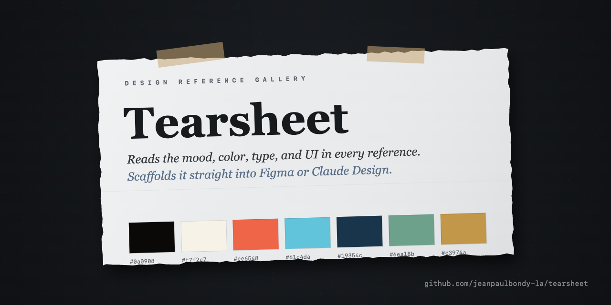
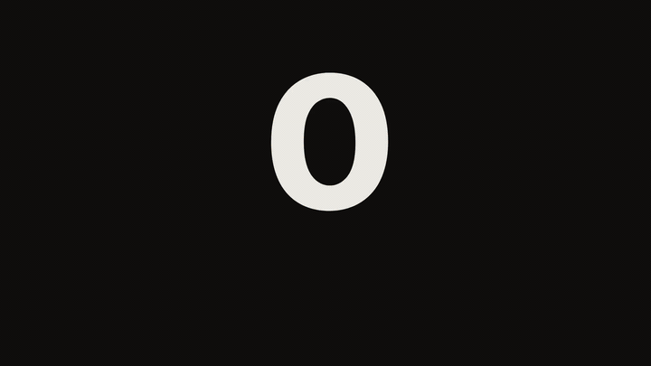
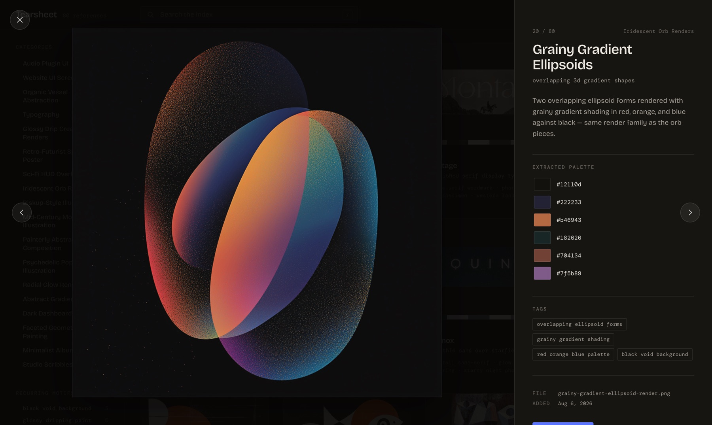

<p align="center">
  
</p>

# Tearsheet

A personal, visual reference gallery that runs on your machine. Drop in images or videos and Claude Code catalogs them, reading each one for its mood, color, type, and UI and extracting a real color palette from the pixels. Browse them as an index, pull a selection into any project as design context, or scaffold the mood, typography, and UI patterns straight into a new Figma file or Claude Design project.

Everything stays local. Nothing is uploaded anywhere unless you explicitly push it.

<p align="center">
  <a href="assets/readme/tearsheet-demo.mp4">
    
  </a>
  <br />
  <sub>From a pile of references to a Figma design system in about 3 minutes. <a href="assets/readme/tearsheet-demo.mp4">Watch the full video with sound</a>.</sub>
</p>

## Requirements

- **[Node.js](https://nodejs.org) 20 or newer** (check with `node -v`)
- **[Git](https://git-scm.com)** to download and update Tearsheet
- **[Claude Code](https://claude.com/claude-code)**, signed in. It writes the descriptions and runs the Figma build, and uses your existing login, so there is no API key to manage
- **macOS** for the Dock app and launcher. The gallery itself also runs from `npm start` on Linux and Windows, but the setup script's launcher is macOS-only
- **A Figma account** (only for "Build File")

## Install

```bash
git clone https://github.com/jeanpaulbondy-la/tearsheet.git
cd tearsheet
npm install && npm run setup
```

`npm run setup` installs the global Claude Code commands (`/use-tearsheet`, `/tearsheet-to-figma`, `/tearsheet-to-design`) into `~/.claude/skills/` and registers the Figma connection with Claude Code (needs [Claude Code](https://claude.com/claude-code) installed). On macOS, it also builds **Tearsheet.app** — drag it onto the Dock to start the server and open the gallery from your menu bar.

<p>
  
</p>

You can also run it by hand from the project folder:

```bash
npm start
```

Then open **http://localhost:4560**. The gallery starts empty.

**One-time Figma sign-in:** run `claude`, type `/mcp`, choose `figma`, and approve access in the browser. After that, "Save for Figma" needs nothing else, and no API key: it runs on your Claude Code login. Start Tearsheet from Tearsheet.app or Terminal, not from inside a Claude Code session.

### Update

```bash
cd tearsheet
git pull
npm install && npm run setup
```

Your library is safe through an update. `images/`, `inbox/`, `data/gallery.json`, and your build history are git-ignored, so `git pull` never touches them. Re-running `npm run setup` is harmless: it refreshes the global commands and the launcher. If you edited a tracked file and `git pull` complains, run `git stash`, then `git pull`, then `git stash pop`.

### Back up your library

Your references live only on your machine. To back them up or move them to a new Mac, copy the `images/` folder and `data/gallery.json`, or put them in a private repo of their own. Don't commit them to a public fork.

### Troubleshooting

| Symptom | Fix |
| --- | --- |
| "Tearsheet was started inside Claude Code" | Start it from Tearsheet.app or a normal Terminal window, not from a Claude Code session |
| New items stay named after their files | Claude Code needs you to sign in again. Run `claude`, type `/login`, then click **Check inbox** |
| "Figma needs a one-time sign-in" | Run `npm run setup -- --figma`, then `claude`, type `/mcp`, choose `figma`, and approve access |
| A build ends with a limit message | You hit your Claude usage limit. The Builds panel marks the run as an error and links the partly built file. Try again after the limit resets |
| The page doesn't load | Another app may be using port 4560. Start with `PORT=4570 npm start` |
| The server is stuck on an old version | Stop it with `lsof -i :4560 -sTCP:LISTEN -t \| xargs kill`, then start Tearsheet again |

## Use

**Add references**

1. Drop image files (`.png`, `.jpg`, `.jpeg`, `.webp`, `.gif`) or video files (`.mp4`, `.mov`, `.webm`, `.m4v`) into the `inbox/` folder.
2. Tearsheet picks them up automatically. On startup it scans `inbox/`; if the server is already running, click **Check inbox** in the top bar. New items appear in the gallery right away with their color palette, then Claude Code looks at each image in the background and writes its real title, tags, category, and description (the button shows "Describing…" and the gallery refreshes when it's done). No prompts or permission gates, and nothing runs while you're idle.

If Claude Code isn't signed in, new items still appear with filename titles, and are described automatically the next time you start Tearsheet or click **Check inbox** after signing in. `/process-inbox` in Claude Code still works if you want to re-describe items by hand.

**Browse**

Reload `localhost:4560`. The index rail on the left lists every category with its count, plus the recurring motifs (tags shared by two or more references). Filters are multi-select; click an active one to clear it. Press `/` to search titles, tags, categories, and descriptions.

Click any image to open it full size with its description, the extracted palette (click a hex value to copy it), and its tags. The arrow keys move through the current result set and `Esc` closes. Every reference has a link of its own (`localhost:4560/#ref=<id>`) that opens straight to this view.

<p align="center">
  
</p>

**Use a selection in another project**

1. Hover a card and click its checkbox to select it (or use the button in the detail view), then **Save for Claude Code**.
2. In Claude Code, in *any* project, run `/use-tearsheet`. Claude pulls in the selected references as design context.

**Or turn a selection into a design-tool starter kit**

Same selection step, then click "Build File" in Tearsheet. It creates a Figma file with color tokens, type styles, and UI components, automatically, by running Claude Code in the background on your Claude login.

### The complete workflow

```
1. Drop images into inbox/
   ↓
2. npm start, or click "Check inbox" if already running (adds items instantly, Claude describes them in the background)
   ↓
3. Browse at http://localhost:4560
   ↓
4. Select images → Click "Build File"
   ↓
5. Figma file builds in the background (about 3 minutes, with several Claude workers building parts of it at once; the button shows progress and the file opens when ready). Close the tab or reload if you like: the Builds button in the top bar lists every build with its status and an "Open in Figma" link, and can cancel one in progress
```

**One-click Figma creation:** Selection → Click → Done. No permission prompts: the server runs Claude Code headless with only the Figma tools allowed, and opens the finished file for you.

**For even more control**, in Claude Code run `/tearsheet-to-figma` or `/tearsheet-to-design` (manual skill invocation gives you prompts and design options).

See `skills/tearsheet-to-figma/SKILL.md` for build details.

## Structure

- `inbox/`: drop zone for new, unprocessed images and videos
- `images/`: processed, renamed images (git-ignored, this is your personal library)
- `data/gallery.json`: metadata for every item, including its extracted palette (git-ignored)
- `public/`: the gallery site (static HTML, CSS, JS; self-hosted type, no external requests)
- `server.js`: serves the site, saves selections, and runs Figma builds as background jobs
- `scripts/figma-build.js`, `scripts/figma-prompts.js`: run several `claude -p` workers in parallel with the Figma MCP (setup, then Foundations, References, and component batches at once)
- `scripts/auto-process-inbox.js`, `scripts/enrich-inbox.js`: add inbox files instantly, then have Claude Code describe them in the background
- `scripts/claude-cli.js`: finds and safely launches headless Claude Code for the scripts above
- `scripts/setup.js`: installs the global commands and builds the macOS launcher
- `scripts/palette.js`, `scripts/video-thumbnail.js`: palette extraction and video frame capture used by `/process-inbox`
- `.claude/skills/process-inbox/`: the `/process-inbox` command (project-scoped, auto-loaded)
- `skills/use-tearsheet/`, `skills/tearsheet-to-figma/`, `skills/tearsheet-to-design/`: the global commands installed by `npm run setup`
- `assets/`: app icon, social preview card, and README images

## License

MIT. Type is Bricolage Grotesque and DM Mono, both under the SIL Open Font License (see `public/fonts/LICENSE.txt`).
